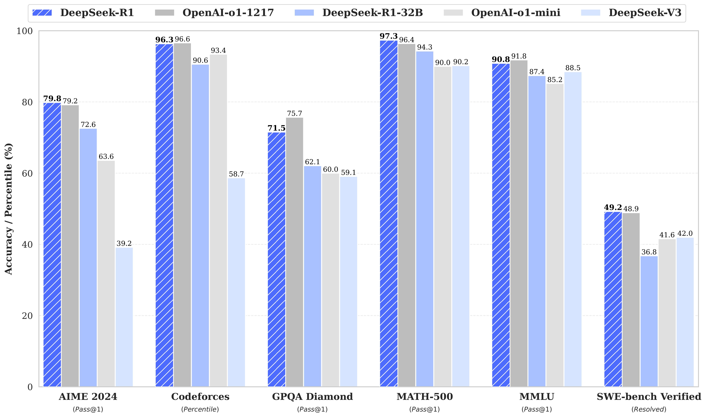

<!--  -->

## Back to Basics: How Data Search Works

If you think about it, searching for data on the internet today is a bit like trying to find a specific book in a huge library—except, instead of shelves, the library is a vast ocean of information scattered across multiple platforms and databases. Current search engines primarily rely on keyword matching and ranking algorithms to provide relevant results. This system works well enough for simple queries but falters when it comes to complex, nuanced searches that require understanding deeper contexts or abstract concepts.

That’s where DeepSeek AI comes in, revolutionizing the way we think about data search. Rather than relying solely on keyword matching, DeepSeek uses advanced AI models to understand not just what you're looking for, but *why* you're looking for it.

### Deep Learning for Contextual Understanding

Where traditional search engines are limited to static rules based on keywords and their frequency, DeepSeek AI integrates cutting-edge deep learning algorithms to understand the context behind each query. DeepSeek's system uses sophisticated natural language processing (NLP) techniques to analyze your request, understand its intent, and retrieve results that best match your desired outcome—even if your query is vague or complex.

For example, if you were to search for "how to improve my team’s performance," a traditional search might simply pull up articles that mention "team performance," without fully understanding that you're looking for management strategies, leadership tips, or employee motivation tactics. DeepSeek AI, on the other hand, would analyze the semantic meaning of your request and return results that are more nuanced and aligned with your specific needs.

### The Power of Reinforcement Learning

One of the key innovations of DeepSeek AI is the integration of reinforcement learning into its search engine. This allows DeepSeek to continuously improve the accuracy and relevance of its results over time, based on user feedback and interaction.

Reinforcement learning is a method where an agent (in this case, the search engine) learns to make decisions by receiving feedback in the form of rewards or penalties. As users interact with the search results, DeepSeek’s AI continuously refines its understanding of what constitutes relevant information, improving future searches.

This means that, over time, DeepSeek AI becomes more intelligent and tailored to individual preferences, much like a personal assistant who learns from every conversation.

### Multimodal Data Search

DeepSeek also stands out with its ability to handle multimodal search queries. Instead of limiting itself to just text, DeepSeek AI is able to process and understand data across multiple formats: images, videos, audio files, and even live data streams. This flexibility allows it to deliver results that are more comprehensive and accurate, addressing all the different types of content users may encounter in their searches.

For instance, if you're searching for a particular product, DeepSeek might not only provide links to articles, but also show you product demos, tutorials, and customer reviews, all related to your search query. Its ability to pull together insights from different media types opens up new possibilities for more immersive and efficient data discovery.

### A Personalized Search Experience

Another powerful innovation of DeepSeek is its personalized search capabilities. By learning from your search history and preferences, the AI continuously tailors the search results to your specific needs, providing a highly personalized and efficient experience. The AI system accounts for both your explicit preferences (such as preferred sources) and implicit preferences (such as your reading speed, engagement with specific content types, and more).

This personalization doesn't just apply to the results themselves but extends to the way information is presented. DeepSeek AI can adjust the layout, summarize lengthy articles, or even highlight key data points, ensuring that you get the most relevant and digestible information quickly.

### Ethical AI in Data Search

With great power comes great responsibility. DeepSeek AI is designed with a strong emphasis on ethical considerations. The team behind DeepSeek has worked hard to ensure that its AI systems are transparent, fair, and unbiased, avoiding the common pitfalls seen in other AI applications. For example, DeepSeek incorporates a variety of safeguards to prevent misinformation, ensure diverse viewpoints, and protect user privacy.

The company is committed to providing a search engine that not only serves user needs but also aligns with principles of equity, fairness, and transparency, fostering trust between AI and its users.

### The Road Ahead

DeepSeek AI is still in the early stages of its journey, but the progress it has made so far is truly remarkable. As more data becomes available, and as the AI continues to learn from user interactions, the potential for this system to completely transform the way we search and interact with information is immense.

The future of DeepSeek AI promises even greater personalization, improved accuracy, and a deeper understanding of the world’s data. Its ability to harness advanced AI techniques and seamlessly integrate them into real-world applications makes it a leader in the next generation of data search.

Stay tuned for more updates and exciting announcements as DeepSeek AI continues to evolve and revolutionize the way we think about search.

---

