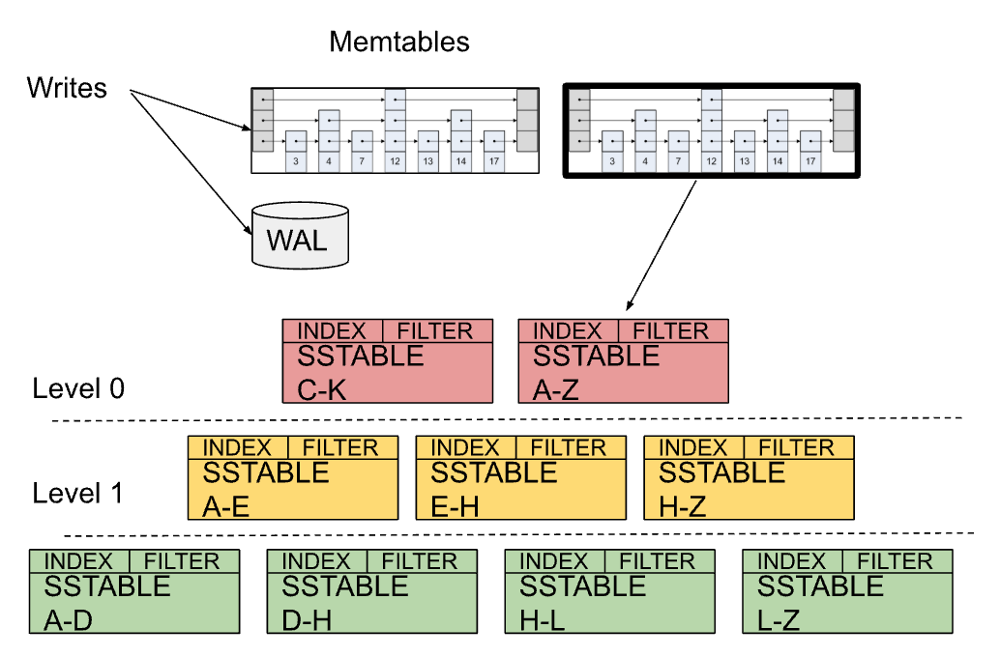
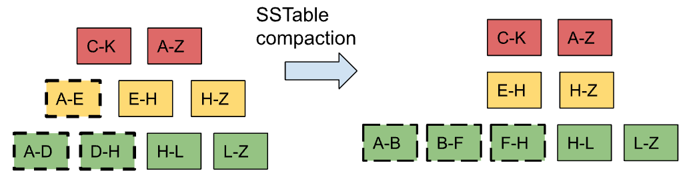

---
layout: post  
title: "Magma Storage Engine"  
usemathjax: true  
---  

## Log structured Merge tree design 
The main components of a LSMT are : 
- Memtable
- SS tables (sorted string table)
- Write Ahead Log

An Lsm tree performs sequential write operations and sequential read operations during compaction 

### Memtable

When we write the writes are implemented as skiplists and then using these skiplists in order to filter out the documents based on the key ranges. When deletes are performed a tombstone marker entry is added, Writes opers are appended to a WAL before addign the entries to the skiplist . The WAL is used for recovery purposes. 
When the Memtable reaches it's limit it's marked as immutable and then a newly created empty Memtable is used for upcoming writes. This immutable memtable is sorted and flushed as an ss table. 
### SS Table 
SS tables are basically sorted key values with a range . A Index is maintained for fast lookup and iter. A Bloom filter is used to optimize the lookups by reporting a Firm NO or a probable yes for a particular level of SS table. The stored Keyvalue pairs can be compressed and referenced as a single big block of context. 
If a SS Table runs out of size then multiple ss Tables are created with contiguous ranges and they form a sorted run. Each level of SS table has a larger range of data so that it can have larger set of document lookups in a particular SS table.
#### Compaction 
when memtable becomes full , the memtable is flushed as SS table , now when the ss Table grows there would be duplicate stale entries that needs to be removed or deleted . Therefore to increase the efficiency of lookups multiple lsm trees are combined together in order to eliminate the duplicates and then limit the read and write amplification.

In the diagram, the SSTable A-E from level-1 can be merged with SSTable A-D and SSTable D-H during compaction. Compaction replaces SSTables A-E, A-D, D-H with one more SSTable with a range A-H at Level 2. The compaction operation can be performed concurrently with coordination for scheduling compaction and updating the SSTable list state. Since the compaction operation involves only small subset of SSTables in the LSM Tree, it provides granular storage garbage collection without significantly impacting concurrent write operations.

#### Read Operation 
A read operation happens in the following manner : 
- it looks up the memtable for the key and subsequently goes to the SS table
- It goes and reads to each higher level of the LSM tree until the key is found , which is optimized by the use of Bloom Filters which help in reducing the amount of table reads to just 4 .
- For range operations the bloom filter optimization is not applicable hence small range reads would suffer much higher read amplification than plasma or B+tree. For large range reads we need to merge the range of read results from all levels .Cost of reads are amortized due to large sequential reads .
- For example if you query for a range A-C and the level 0 has range A-B , level 1 has range A-F , level 2 has range A-K and so on , we query each of the ss table in each level parallely and then provide the results which makes reads costiler than using plasms or a B+tree.

#### Lookup Operation:
1. **Start with Memtable (Level 0):**
   - Check the in-memory Memtable first. If the key is found, return immediately.
   
2. **Bloom Filter Utilization:**
   - For each subsequent level (e.g., Level 1 to Level n), use Bloom Filters to quickly 
determine if a key might exist within an SSTable without performing I/O operations.
   - Only perform actual reads on SSTables where the Bloom Filter indicates a potential 
presence of the key.

3. **Non-Overlapping Ranges:**
   - Each level's SSTables have non-overlapping ranges, ensuring that only one SSTable per 
level needs to be checked for any given key, minimizing read amplification.

#### Range Operation:
1. **Check Memtable (Level 0):**
   - Include keys from the Memtable within the specified range.

2. **SSTable Overlaps:**
   - For each subsequent level, check all SSTables whose key ranges overlap with the query 
range.
   
3. **Handling Different Ranges:**
   - **Small Ranges:** May involve multiple I/O operations as several small SSTables across 
different levels might cover parts of the range, leading to higher read amplification 
compared to B+Trees.
   - **Large Ranges:** Efficient due to sequential reads from multiple levels, amortizing 
the cost and making the operation nearly as efficient as with B+Trees.

#### Merge operation 
when a update happens we have to provide the completely updated value since the kv store allows partial update we then need to combine the values at multiple revisions in order to return the final updated result.
Therefore when a lookup is performed if there exists a merge operator tag , it indicates the current key value pair is partial and needs to fetch the remaining values from the subsequent levels and then merge them in order to return the final value. The merge operator function can be custom defined . 

#### Snapshots 
All the writes are assigned a sequence number and when a snapshot is created it tracks all the list of SSTables files , WALs and the most recently written sequence number. all these files are then pinned and aren't deleted until the snapshot is destroyed . to perform a rollback the database can be reopened after creating the newly created ss tables after the snapshot had been created . During reopen all the opers after the creation of the snapshot are discarded.

#### Value store design
the index store is used to maintain the index by keeping the keys in multi level sort ordered tables.
The value store doesn't require any sort of sorted arrangement by it's document key . The high write amplification due to the result of sorting it from time to time based on the key is also removed . the values are stored in the most efficient manner without maintaining the order . Usage of log structured storage approach. 

here's what happens when a value is inserted : 
- it is added to the value store which returns a reference pointer to the value.
- the reference pointer is then stored alongwith the key for lookups and locating it. Which are inserted into the LSM tree based index .
- when a document needs to be fetched , a lookup by key on by-id LSM tree is performed to obtain the value pointer .
**Main Components of Value Store**:
  - **Multiple Logs**: Sequential storage for data.
  - **In-Memory Log Metadata**: Manages metadata about stored logs.
  - **Metadata Write-Ahead Log (WAL)**: Ensures durability by logging changes before committing to storage.
  - **Metadata Checkpoints**: Periodic saves of the metadata state to stable storage, aiding in recovery and consistency.

### KV Store integration 
The kv store has a natural scope for sharding the data by vbuckets . Each shard is called a **kvstore** .
The kv engine doesn't need to support range queries across multiple vbuckets.
The kvstore implementation of the storage engine consists of three LSM trees: 
- By-id Index
- By-seq index
- _local index (optional , can be implemented without a LSM tree)
- value store

A lsm wal is shared across the three LSM trees. The value store has seperate WAL. it could be a possibility to merge value store and lsm tree wal to avoid extra fsyncs . 

#### Write operation 
Every write operation is a upsert operation therefore actual item count cannot be estimated . Therefore after every upsert op we do a lookup . 
Every upsert writes into a by-id and a seq-id  . if the value is bigger than the configured threshold , value is stored in the value store and the by-id index value is updated with the value pointer . 
A delete operation upserts the value with a tombstone value which is removed during compaction . 
Since we don't distinguish between the update and a insert the prior versions of the documents are still remained in the seq index .These stale entries are deleted by the garbage collector in a lazy manner . These can be applied to the by-seq LSM tree during compaction . 
#### By-ID lookup 
the lookup operation using the by-id index is straightforward . the by-id LSM tree obtains the most recent version of the document key . if a value pointer exists , an additional read is performed against the value store to obtain the document . 
#### By-Seq iteration 
the kvengine requires by-seq iteration to return deduplicated document entries from a snapshot . since we perform deletes in a lazy manner , by-seq index consists of stale entries . An extra lookup into the by-id tree is performed to chekc the validity of the entry by comparing the seq number .Therefore the de-duplication snapshot semantics can be provided by the by-seq iteration . 

The Value Store Design is a sophisticated system that efficiently manages document storage 
and retrieval by separating keys from their content. Here's an organized summary of the key 
components and their roles:

1. **Value Store**:
   - **Purpose**: Manages large values separately from document keys, enhancing performance 
for read operations.
   - **Storage**: Handles actual document content, reducing data size in LSM Trees.
   - **GC Mechanism**: Manages garbage collection to remove outdated or invalid entries, 
ensuring efficient storage and performance.

2. **Indexes**:
   - **By-Id Index**: An LSM Tree optimized for fast point lookups using document IDs.
     - **Functionality**: Allows quick access to documents by their unique ID.
     - **Storage**: Maintained within its own LSM Tree in the kvstore, separate from other 
structures.
   - **By-Seq Index**: Another LSM Tree supporting ordered queries based on sequence 
numbers.
     - **Functionality**: Facilitates operations requiring ordered iteration, such as 
replication or backups.
     - **Storage**: Also maintained separately to optimize for range queries and ordered 
access.

3. **KV-Store Architecture**:
   - Each kvstore contains multiple LSM Trees (by-id, by-seq, _local) tailored to specific 
operations.
   - The Value Store has its own Write-Ahead Log (WAL), potentially merged with LSM Trees' 
WALs for efficiency.

4. **Operations and Coordination**:
   - **Writes (Upserts)**: Both by-id and by-seq indexes are updated, ensuring data 
consistency.
   - **Reads**: By-id index provides fast lookups, while the Value Store retrieves actual 
content.
   - **Compactions and GC**: Coordinate to clean up obsolete entries, preventing storage 
bloat.

5. **Considerations**:
   - **Tombstones (Deletes)**: Handled lazily; by-seq indexes may accumulate stale entries 
until compaction.
   - **Performance Trade-offs**: Separate LSM Trees allow optimization for specific access 
patterns, balancing performance and efficiency.
