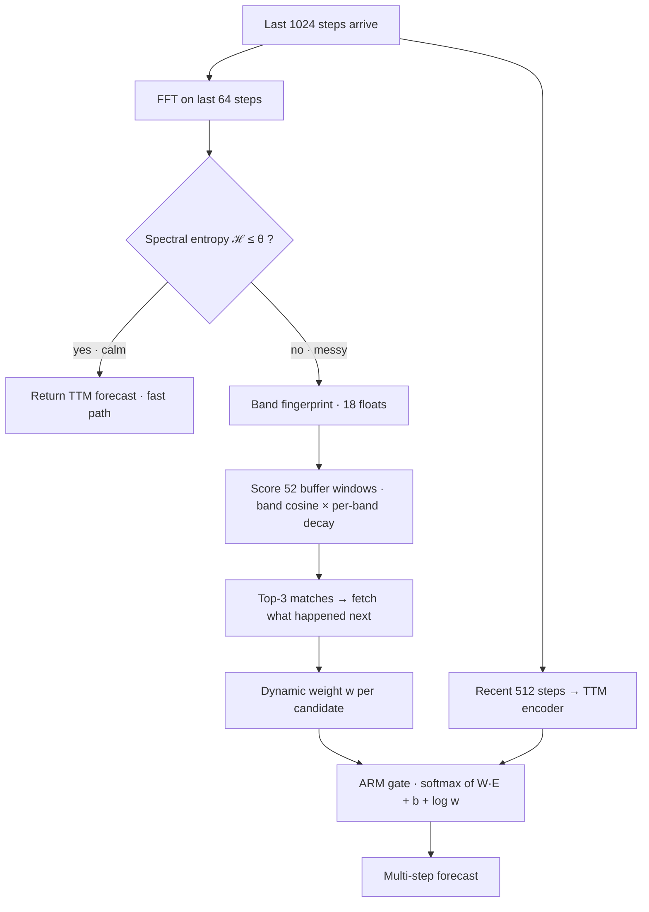

*September 12, 2026*

---
*Notes from an in-progress research project on low-latency, retrieval-augmented forecasting with Tiny Time Mixers*

> **Status:** paper in preparation. Every number below marked *expected* or *target* is a hypothesis we are testing, not a result we are reporting. That's the fun part: you get to watch the bets get settled.

---

## Pick your path

You don't have to read this top to bottom. Pick the door that fits you:

| If you are... | Start here |
|---|---|
| Curious, short on time | [The one-sentence pitch](#the-one-sentence-pitch) |
| A practitioner who hates running FAISS in prod | [Idea 1: the buffer replaces the database](#idea-1-the-buffer-replaces-the-database) |
| A signal-processing nerd | [Idea 2: band fingerprints](#idea-2-band-fingerprints) |
| Here for the games | [Game 1: Spot the spectral twin](#game-1-spot-the-spectral-twin) |
| A reviewer looking for holes | [The hypothesis board](#the-hypothesis-board) |

---

## The one-sentence pitch

SIREN combines a tiny pretrained time-series foundation model, band-structured spectral retrieval, per-band decay that actually receives gradient, and an entropy gate that skips retrieval when it isn't needed, all **without an external database**.

Three numbers frame the whole project:

```
  ~1M            0 KB              ~85%
parameters    external index    expected skip rate
 (TTM)        (1024-step RAM    (on calm signals like
               window only)      electricity load)
```

---

## A puzzle to start with

Here's something that bothered me early on. In language modelling, more context usually helps. In time-series forecasting, it often doesn't. Past a certain point, **adding more history makes forecasts worse**.

Why would more information hurt?

<details>
<summary><b>Think about it, then click</b></summary>

<br>

Because the model starts averaging. A sharp, recent signal gets diluted by a long tail of old patterns that may no longer apply. A market regime from 2008 and one from 2024 don't follow the same rules, but a model that weighs all history equally treats them as equally informative.

This "inverse scaling" with history length is the first thread SIREN pulls on. If old data can hurt, then *what* you retrieve and *how old it is* matters as much as *whether* you retrieve.

</details>

---

## Four problems with retrieval for time series today

Retrieval-augmented generation (RAG) works wonders for text. Bolting it onto time series exposes four rough edges.

**1. More history, worse forecasts.** The inverse-scaling puzzle above.

**2. Spectral blindness.** Standard similarity (cosine, L2) compares raw shapes. Two windows can share the exact same rhythm and still score as strangers, because one is shifted up or carries more noise. (You'll test this yourself in [Game 1](#game-1-spot-the-spectral-twin).)

**3. Concept drift.** Dynamics change. Retrieval that ignores age treats a pattern from years ago as just as valid as one from last week.

**4. Database overhead.** Standard time-series RAG needs a vector database (FAISS, HNSW), an index-build pipeline, disk storage, and retrieval latency, all before a single prediction is made.

SIREN's bet is that you can address all four with ideas that are each small, testable on their own, and cheap.

---

## Idea 1: the buffer replaces the database

Instead of an index over millions of historical windows, SIREN keeps a **1024-step circular buffer in RAM**. That's it. That's the knowledge base.

```
  t−1024                    t−513 │ t−512                      t
  ┌───────────────────────────────┼──────────────────────────────┐
  │  older half                   │  recent half                 │
  │  → extra spectral candidates  │  → what TTM actually sees    │
  └───────────────────────────────┴──────────────────────────────┘
          ▲                                                  │
          └──── oldest fingerprint falls off ◄── new one in ─┘
```

Every time step, one new fingerprint comes in and one old one is evicted. The cost per step is always **one FFT**. No index rebuilds, no disk reads.

The split matters too. TTM was pretrained with a 512-step context, so it never sees more than the recent half. The older half exists purely to supply retrieval candidates.

<details>
<summary><b>Watch the buffer move (click to animate in your head)</b></summary>

<br>

```
step t      [ w01 w02 w03 ... w51 w52 ]
                                       ← new window arrives
step t+16   [ w02 w03 w04 ... w52 w53 ]   w01 is gone, forever
step t+32   [ w03 w04 w05 ... w53 w54 ]   w02 is gone, forever
```

The neat side effect: **stale data cannot be retrieved**, structurally. It doesn't need to be filtered or down-weighted to zero. It simply isn't there anymore.

</details>

The trade is stark: **52 candidate windows in memory vs millions in a FAISS index**. The open question is whether 52 well-chosen, recent candidates can compete with millions of indexed ones. That's exactly what Step 2 of the build plan measures.

---

## Idea 2: band fingerprints

Here's where it gets interesting. SIREN doesn't describe a window by its raw shape. It describes it by its **dominant rhythms**, split into three frequency bands.

Take a 64-step window, run a real FFT, and you get 33 frequency bins (0 to 32). Then:

| Band | FFT bins | Intuition | Decay rate λ |
|---|---|---|---|
| Low | 1 – 8 | slow rhythms inside the window | 0.002 (forgets slowly) |
| Mid | 9 – 28 | medium rhythms | 0.012 (moderate) |
| High | 29 – 32 | fast jitter near the noise floor | 0.100 (forgets fast) |

**Bin 0 is always dropped.** It encodes the window's mean, which is a level, not a rhythm.

From each band, keep the **top-2 bins by amplitude**. Store each one's bin index, amplitude, and phase:

```
3 bands × 2 bins × 3 numbers = 18 floats
```

Compare that to a full-spectrum key (33 bins × amplitude and phase = 66 floats). That's about **3.7× smaller**.

But size isn't the main point. The main point is **guaranteed representation**. In full-spectrum approaches, the slowest, highest-energy rhythm tends to dominate the similarity score. Band fingerprints force the medium and fast structure to have a voice, every time.

> **Research-curious aside:** a bin's period in steps is W / k. With W = 64, bin 1 is a 64-step rhythm and bin 32 is a 2-step rhythm. So *which* real-world cycles land in each band depends on your sampling rate. Hourly and 15-minute data put the same daily cycle in different bins. Worth keeping in mind when reading the ablations.

---

## Game 1: Spot the spectral twin

Here are three signals. Which one is **A's true twin**, meaning it shares A's rhythm?

```
A:  ▁▃▆█▆▃▁▃▆█▆▃▁▃▆█▆▃▁▃▆█▆▃
B:  ▄▅▇█▇▅▄▅▇█▇▅▄▅▇█▇▅▄▅▇█▇▅
C:  ▁▂▃▄▅▆▇█▇▆▅▄▃▂▁▂▃▄▅▆▇█▇▆
```

Make your guess before opening.

<details>
<summary><b>Reveal</b></summary>

<br>
B is the twin. It repeats every 6 steps, just like A. It's just shifted up and squashed.

<br>
C has a much slower rhythm (period ~14), but it spans the full range of values like A does. A raw L2 or cosine comparison on these shapes can easily rate C as "closer" to A than B, because B's offset pushes every point away.

That's spectral blindness in one picture. Strip out the mean (bin 0), look at which rhythms are present, and A and B light up the same bins. C doesn't.

</details>

---

## Idea 3: the entropy gate

Not every forecast needs help. If the signal is clean and cyclical, a good backbone alone does fine. Retrieval is wasted compute.

So SIREN asks one question before retrieving: **how chaotic is this signal right now?**

The answer is **spectral entropy**, written here as ℋ. Normalize the power spectrum into a probability distribution and compute its entropy. One dominant rhythm gives low ℋ. Power smeared everywhere gives high ℋ.

And it's essentially free, because the FFT was already computed for the fingerprint. It's one more sum.

```
if ℋ ≤ θ:   signal is calm   → return TTM's forecast, skip retrieval
if ℋ > θ:   signal is messy  → retrieve and fuse
```

θ is a single scalar, tuned per dataset on a validation split. No new learnable parameters.

**Expected skip rates** (hypotheses, to be measured):

```
Electricity  ████████████████████████████████████████░░░░░░░  ~85%
ETTh1        ███████████████████████████████░░░░░░░░░░░░░░░░  ~65%
Crypto       ███████░░░░░░░░░░░░░░░░░░░░░░░░░░░░░░░░░░░░░░░░  ~15%
```

To our knowledge, entropy-gated retrieval hasn't been used in time-series forecasting. Self-RAG does adaptive retrieval in NLP, but nothing equivalent exists in TSF yet.

---

## Game 2: You are the gate

You're the entropy gate. For each signal, decide: **OPEN** (retrieve) or **CLOSED** (trust TTM alone)?

```
1.  ▁▄█▄▁▄█▄▁▄█▄▁▄█▄▁▄█▄▁▄█▄
2.  ▃▇▁▅█▂▆▃▁▇▄▂█▅▁▆▃▇▂▄█▁▅▃
3.  ▁▃▅▇█▇▅▃▁▃▅▇█▇▅▃▁▂▇▁█▃▆▂
4.  ▄▄▅▄▄▅▄▄▅▄▄▅▄▄▅▄▄▅▄▄▅▄▄▅
```

<details>
<summary><b>Check your calls</b></summary>

<br>

1. **CLOSED.** One clean rhythm. Low ℋ. TTM handles this.
<br>
2. **OPEN.** No dominant rhythm, power everywhere. High ℋ. This is crypto-on-a-bad-day territory.
<br>
3. **OPEN (probably).** Clean for two cycles, then it breaks. If the query window covers the break, ℋ jumps. This is the most interesting case: a *regime change*, where retrieval earns its keep.
<br>
4. **CLOSED.** Tiny, regular wiggle. Low ℋ, even though the amplitude is small. Entropy cares about *how spread out* the power is, not how big it is.
<br>

If you got 3 right, you've already understood why gating has to be computed fresh at every step.

</details>

---

## Idea 4: dynamic weights inside the ARM gate

When retrieval does fire, SIREN takes the **top-3 matches** and fetches what happened *after* each one, the futures that followed. Those futures get injected into TTM through an **Adaptive Retrieval Mixer (ARM)**.

Each candidate gets a weight, recomputed at every inference call:

```
w = match_quality^β × exp(−λ_band · Δt) × exp(−γ · ℋ · Δt)
     ─────────────   ─────────────────   ────────────────
     how similar?    how old, for this   how old, scaled by
                     band's rhythm?      how chaotic things
                                         are right now?
```

That weight enters the gate's softmax directly:

```
α = Softmax(W·E + b + log w)
```

The piece that matters: λ_band, β, and γ are **learned jointly with the ARM fusion weights**. The decay rates get gradient signal through the gate. SpecReTF, the closest prior work, applies a post-hoc scalar EMA with no gradient and no band structure. That gap is the architectural claim at the heart of SIREN.

Read the third factor carefully, because it's subtle. When the signal is chaotic (high ℋ), old matches decay *faster*. The intuition: in turbulent conditions, last week's analogues are less trustworthy than they'd be in calm conditions.

---

## Game 3: Which candidate wins?

You've retrieved three candidates. Settings: β = 2, γ = 0.002, current ℋ = 0.7. All three matched in the **mid band** (λ = 0.012).

| Candidate | Match quality | Age Δt (steps) |
|---|---|---|
| A | 0.95 | 400 |
| B | 0.70 | 60 |
| C | 0.85 | 150 |

Which gets the biggest weight? Place your bet.

<details>
<summary><b>Reveal round 1</b></summary>

<br>

| Candidate | quality^β | age decay | chaos decay | **w** |
|---|---|---|---|---|
| A | 0.903 | 0.008 | 0.571 | **0.004** |
| B | 0.490 | 0.487 | 0.919 | **0.219** ✅ |
| C | 0.723 | 0.165 | 0.811 | **0.097** |

**B wins.** The best match (A) is nearly ignored, because at 400 steps old, a mid-band pattern has decayed to almost nothing.

Now the twist. Same candidates, same numbers, but they all matched in the **low band** (λ = 0.002). Who wins now?

<details>
<summary><b>Reveal round 2</b></summary>

<br>

| Candidate | quality^β | age decay | chaos decay | **w** |
|---|---|---|---|---|
| A | 0.903 | 0.449 | 0.571 | **0.232** |
| B | 0.490 | 0.887 | 0.919 | **0.400** |
| C | 0.723 | 0.741 | 0.811 | **0.434** ✅ |

**C wins.** Slow rhythms stay relevant longer, so age hurts less, and C's better match quality pulls ahead of B.

Same candidates, different band, different winner. That's per-band decay doing its job: *how long a memory stays useful depends on which rhythm it describes.*

</details>

</details>

---

## The whole pipeline, end to end



Notice how much happens before the decision at D: one FFT. If the gate closes, that's the entire retrieval overhead.

---

## Play with it yourself

Here's a minimal sketch of the two core primitives. Paste it into a notebook and poke at it.

```python
import numpy as np

BANDS = {"low": range(1, 9), "mid": range(9, 29), "high": range(29, 33)}

def fingerprint(window, k=2):
    """Band fingerprint: top-k bins per band → (bin, amplitude, phase)."""
    X = np.fft.rfft(window - window.mean())   # 33 bins for W=64; bin 0 ≈ 0
    amp, phase = np.abs(X), np.angle(X)
    fp = []
    for idx in BANDS.values():
        idx = np.array(idx)
        top = idx[np.argsort(amp[idx])[-k:][::-1]]
        for b in top:
            fp += [b, amp[b], phase[b]]
    return np.array(fp)                        # 3 × k × 3 = 18 floats for k=2

def spectral_entropy(window):
    """Normalized spectral entropy in [0, 1], excluding bin 0."""
    X = np.fft.rfft(window - window.mean())
    p = np.abs(X[1:]) ** 2
    p = p / p.sum()
    return -(p * np.log(p + 1e-12)).sum() / np.log(len(p))

t = np.arange(64)
clean = np.sin(2 * np.pi * t / 16)
noisy = clean + np.random.randn(64) * 0.8

print("clean ℋ:", round(spectral_entropy(clean), 3))   # near 0
print("noisy ℋ:", round(spectral_entropy(noisy), 3))   # much higher
```

**Challenges to try:**

- [ ] Find the noise level at which `noisy`'s entropy crosses 0.5.
- [ ] Add a second sine at period 4 to `clean`. Which band does it land in?
- [ ] Shift `clean` up by +10. Does the fingerprint change? (It shouldn't. Why?)

---

## Quick quiz

Five questions. Answers are hidden. No peeking.

**Q1.** Why is FFT bin 0 always excluded from the fingerprint?

<details><summary>Answer</summary>

It's the window's mean, a level rather than a rhythm. Including it would reintroduce exactly the offset sensitivity that makes raw-shape similarity spectrally blind.

</details>

**Q2.** If the gate skips retrieval 85% of the time, by roughly how much does retrieval compute drop?

<details><summary>Answer</summary>

Retrieval runs 15% of the time, so compute drops by 1 / 0.15 ≈ **6.7×**. At a 65% skip rate it's about 2.9×. At 15%, barely 1.2×. The gate's payoff depends heavily on the dataset, which is why skip rate gets logged per dataset.

</details>

**Q3.** The buffer holds 1024 steps. Why does TTM only see 512?

<details><summary>Answer</summary>

TTM was pretrained with a 512-step context. Feeding it more would break the assumptions its weights were trained under. The older half exists only to provide retrieval candidates.

</details>

**Q4.** In SIREN, what happens to a pattern that's 2,000 steps old?

<details><summary>Answer</summary>

Nothing, because it no longer exists. It fell off the buffer long ago. Staleness is handled structurally, not by filtering.

</details>

**Q5.** What's the key difference between SIREN's decay and SpecReTF's?

<details><summary>Answer</summary>

SpecReTF uses a single post-hoc scalar EMA with no gradient. SIREN uses a separate decay rate per frequency band, and those rates are learned through the ARM gate, so they receive gradient from the forecasting loss.

</details>

---

## How SIREN sits among prior work

| System | External DB | Fingerprint | Per-band decay | Entropy gate | Backbone |
|---|---|---|---|---|---|
| RAFT-Han | Yes | No (Pearson) | No | No | MLP |
| TimeRAF | Yes | No (MLP) | No | No | TTM |
| TS-RAG | Yes | No (L2) | No | No | Chronos-Bolt |
| SpecReTF | Yes | Full STFT | Scalar EMA only | No | Linear |
| CRAFT | Yes | Full spectrum | No | No | None |
| **SIREN** | **No, in-memory** | **Low · Mid · High** | **Per-band + gradient** | **Entropy-based** | **TTM** |

---

## The build plan (follow along)

Each step produces a runnable, benchmarkable system. No step depends on a later one to show results. That's deliberate: if Step 4 fails, Steps 1 to 3 still stand.

- [ ] **Step 1 · TTM + ARM baseline.** Frozen TTM-Base, TS-RAG's ARM ported onto TTM's output projection, L2 over mean-pooled embeddings as a placeholder retriever. Fine-tune ARM only on ETTh1. *Goal: match TimeRAF (ETTh1 MSE 0.359) and TS-RAG (0.3557). A verified baseline, not a win.*
- [ ] **Step 2 · In-memory buffer.** Remove FAISS/HNSW entirely. 1024-step circular buffer, W = 64, stride 16. Inject the futures that followed each match. *Expected: MSE close to Step 1. The latency table is the win.*
- [ ] **Step 3 · Band fingerprints.** Replace L2 with band fingerprints and per-band overlap-cosine with phase agreement. Ablate K per band (1 to 4) and band contributions (Low only → Low+Mid → all three).
- [ ] **Step 4 · Entropy gate.** Add ℋ, tune θ per dataset, log skip rate, report MSE stratified by gate-open vs gate-closed.
- [ ] **Step 5 · Per-band decay + dynamic w + top-3.** Eight new learnable parameters trained jointly with ARM. *Target: ETTh1 MSE below 0.340.*

```
Week 1  ██ Step 1 · baseline
Week 2  ██ Step 2 · buffer + latency vs FAISS
Week 3  ██ Step 3 · fingerprints + ablations
Week 4  ██ Step 4 · entropy gate
Week 5  ████ Step 5 · decay, dynamic w, full ablations
Week 7  ██ Finance benchmarks
Week 8  ██ Paper draft
```

---

## Where it gets tested

**Energy** (needed to enter the SpecReTF / TimeRAF / TS-RAG comparison tables, horizons 96, 192, 336, 720): ETTh1 and ETTh2 (hourly transformer temperature), ETTm1 and ETTm2 (15-minute), Electricity (321 clients, hourly, 2012 to 2014), and Weather (21 channels, 10-minute).

**Finance**: the M4 Finance subset and Exchange Rate (8 currency pairs, daily) match the RAFT-Han and TimeRAF baselines. **BTC-USD and ETH-USD** hourly data is the new frontier, since no prior work benchmarks this style of retrieval on crypto. It's also where the entropy gate should open most often, which makes it the hardest and most interesting test.

---

## The hypothesis board

This is what I'm actually betting on. Each one can fail independently, and I'd rather know.

| # | Hypothesis | How it gets tested | Status |
|---|---|---|---|
| H1 | 52 in-memory candidates can match a FAISS-backed retriever on MSE | Step 2 vs Step 1 | 🔬 open |
| H2 | Band fingerprints beat full-spectrum keys because medium/fast bands get a voice | Step 3 band ablation | 🔬 open |
| H3 | The entropy gate skips most retrievals on calm data with no MSE loss | Step 4 stratified MSE | 🔬 open |
| H4 | Learned per-band decay beats a single scalar decay | Step 5 vs scalar-λ ablation | 🔬 open |
| H5 | Gains hold on crypto, where most steps are high-entropy | Week 7 benchmarks | 🔬 open |

**Your turn:** which of these do you think breaks first? My money's on H1 being the closest call. If you have a strong opinion, or a reason one of these is already doomed, I genuinely want to hear it.

---

## Why this matters beyond benchmarks

At Xflow, forecasting lives inside time-critical financial infrastructure. A model that needs a vector database, an index-rebuild job, and a disk read before every prediction is a model with three more things that can page you at 3 a.m.

SIREN's real question isn't "can we beat the leaderboard?" It's this: **how much of retrieval's benefit can you keep while deleting almost all of its infrastructure?** If the answer turns out to be "most of it," that's useful well beyond one paper.

Stay tuned. The baselines are first.

---

*Questions, critiques, or a dataset you think would break SIREN? please reach out via email, twitter, linkedin etc. do checkout [my github](github.com/capnmav77)*

---