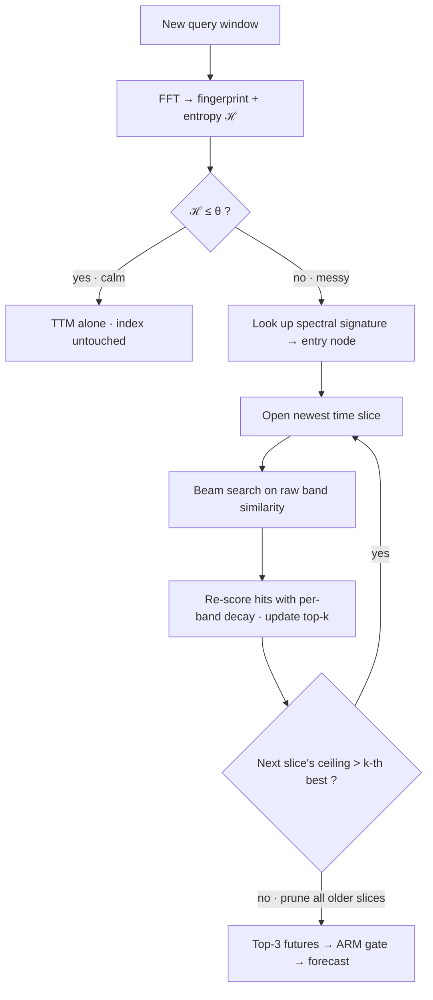

*October 04, 2026*

---
*Part 2 of the SIREN series: a barebone graph index over spectral fingerprints, built for long context and small memory*


> **Status:** design proposal. In Part 1, SIREN's headline was *no external database*. This post asks what happens when the 1024-step buffer isn't enough, and proposes the smallest index that could possibly work. Every number marked *expected*, *target*, or *back-of-envelope* is a hypothesis, not a result.

---

## Pick your path

| If you are... | Start here |
|---|---|
| Wondering why a "no database" project now wants an index | [The plot twist](#the-plot-twist) |
| Here for the games | [Game 1: How far back can each band see?](#game-1-how-far-back-can-each-band-see) |
| An ANN / vector-search person | [The design in four pieces](#the-design-in-four-pieces) |
| Counting bytes | [The memory math](#the-memory-math) |
| Want to run something now | [Play with it yourself](#play-with-it-yourself) |
| A reviewer looking for holes | [What could break](#what-could-break) |

---

## SIREN in 60 seconds

If you missed Part 1, here's the short version. SIREN is a retrieval-augmented forecaster built on a ~1M-parameter Tiny Time Mixer (TTM). Instead of a vector database, it keeps a **1024-step circular buffer** in RAM. Each 64-step window is described by an **18-float band fingerprint**: the top-2 FFT bins in each of three frequency bands (low, mid, high), stored as bin, amplitude, and phase. A **spectral entropy gate** skips retrieval when the signal is calm. When retrieval fires, matches are weighted by similarity and a **learned, per-band decay**, and fused through an Adaptive Retrieval Mixer.

All of this lives in 52 candidate windows. No index needed.

---

## The plot twist

So why build an index?

Because "52 windows" is a choice, not a law of nature. It works beautifully for one series and a short memory. But three situations blow it up:

1. **Cross-series retrieval.** Electricity has 321 clients. The best analogue for client 17's messy Tuesday might be client 204's messy Tuesday. Searching all clients' recent windows turns 52 candidates into tens of thousands.
2. **Learned decay that remembers more.** SIREN *learns* its decay rates. If training decides slow rhythms stay relevant for months, the useful past gets much longer.
3. **Finer strides.** Stride 16 is a convenience. Stride 1 multiplies the candidate pool by 16.

At that scale, a flat scan starts to hurt, and the obvious move is to reach for FAISS or HNSW. This post argues that the obvious move is the wrong one for time series. It also proposes a lighter one.

---

## Game 1: How far back can each band see?

SIREN's per-band decay is `exp(−λ · Δt)`. Using Part 1's starting values, at what age does each band's weight fall below **1%**?

| Band | λ |
|---|---|
| Low | 0.002 |
| Mid | 0.012 |
| High | 0.100 |

Hint: solve `exp(−λ · Δt) = 0.01`.

<details markdown="1">
<summary><b>Reveal</b></summary>

<br>

`Δt = ln(100) / λ ≈ 4.6 / λ`

| Band | Fades below 1% at | On hourly data |
|---|---|---|
| Low | ~2,303 steps | ~96 days |
| Mid | ~384 steps | ~16 days |
| High | ~46 steps | ~2 days |

**Here's the twist that shaped this whole design.** The decay *already defines a horizon*. For a single series at these values, everything older than ~2,300 steps contributes essentially nothing. With stride 16, that's about 144 live windows. For 144 windows, brute force wins, and you don't need an index.

So the index isn't for "one series, very long history." It's for **many series**, **learned decays that shrink**, and **fine strides**. In those regimes the live pool grows fast. With 321 series × 144 windows, you have roughly 46,000 live candidates per query. If λ_low learns its way down to 0.0002, the horizon grows tenfold.

Keep this game in mind, because the index's best trick (pruning) comes straight out of it.

</details>

---

## Why not just use FAISS or HNSW?

HNSW is a brilliant general-purpose index. But SIREN's workload breaks four of its assumptions.

**1. It's time-blind.** HNSW ranks by raw similarity. SIREN ranks by *decayed* similarity. The usual fix is over-fetching: pull the top 50 by similarity, apply decay, then keep the top 3. On a two-year hourly series, a clean daily pattern repeats ~730 times. The raw top 50 can easily be dominated by year-one windows that decay to nothing. The recent, slightly-less-similar windows that *should* win were never fetched.

**2. It hates deletions.** A sliding window evicts something every step. Deleting a node from an HNSW graph means repairing its neighbors' links, or leaving tombstones that rot recall over time.

**3. It's sized for big vectors.** Typical foundation-model embeddings are hundreds of floats. SIREN's fingerprint is 18 numbers, and most of it compresses to single bytes. The links in an HNSW graph would outweigh the vectors they connect.

**4. It doesn't speak "bands."** SIREN's similarity is a weighted sum of per-band overlap-cosines with phase agreement. That isn't the L2 or inner product an off-the-shelf index assumes.

---

## The design in four pieces

Working name: **SIREN-Graph**. It's HNSW stripped to the bone, then fitted to time series.

### Piece 1: a tiny node

Each window becomes one node:

```
┌────────────────────────────────────────────────────────────┐
│ fingerprint   6 × (bin uint8 + amp fp16 + phase uint8) 24 B │
│ address       series_id uint16 + time uint32           6 B │
│ links         16 neighbours × uint16                  32 B │
└────────────────────────────────────────────────────────────┘
                                                  ≈ 62 bytes
```

Bins fit in a byte (0 to 32). Phase quantized to 256 levels gives ~1.4° resolution. Links can be 16-bit because each graph is small (more on that in Piece 3).

### Piece 2: drop the hierarchy ("HNSW without the H")

HNSW's upper layers exist to find a good starting point for the search. SIREN already has a free one: **the dominant bin in each band**.

```
signature = (top bin in low, top bin in mid, top bin in high)
          → 8 × 20 × 4 = 640 possible signatures
```

A small hash table maps each signature to the newest node that has it. A query looks up its own signature and starts its walk right in the spectral neighborhood it belongs to. One flat graph layer plus a 640-entry table replaces the whole hierarchy.

### Piece 3: time slices instead of deletions

The graph isn't one big structure. It's a queue of **time slices** (say, 256 steps each). Each slice holds windows from *all* series that ended in that time range, wired into its own small graph.

```
 oldest                                                    newest
 ┌──────┐ ┌──────┐ ┌──────┐ ┌──────┐ ┌──────┐ ┌──────┐ ┌──────┐
 │ seg  │ │ seg  │ │ seg  │ │ seg  │ │ seg  │ │ seg  │ │ seg  │ ← inserts
 └──────┘ └──────┘ └──────┘ └──────┘ └──────┘ └──────┘ └──────┘
    ▲
    └── evicted whole when it ages out. No link repair, ever.
```

New windows only ever go into the newest slice. Once a slice closes, it's frozen. Eviction is FIFO, so you drop an entire slice at once. That removes the deletion problem completely.

### Piece 4: decay-aware search with a provable skip

Here's the payoff from Game 1. SIREN's score for a candidate is:

```
score = Σ_band  w_band · sim_band · exp(−λ_band · Δt)
```

Band weights sum to 1, and every per-band similarity is at most 1. That gives a hard ceiling:

```
score  ≤  exp(−λ_min · Δt)
```

So search goes **newest slice first**, keeping a running top-k. Before opening each slice, compute the ceiling using the slice's *youngest* window. If that ceiling can't beat your current k-th best, stop. Every older slice has an even lower ceiling, so you skip it and everything behind it.

Notice what this does. The model's learned decay **directly sets the query budget**. If SIREN learns to forget fast, queries get cheaper. If it learns to remember long, it searches deeper. Nobody tunes a separate knob.

---

## Game 2: The greedy walk trap

Graph search walks from node to node, always stepping to the neighbor most similar to the query. Here's a tiny graph. The numbers are similarity to your query. You start at **E**.

```
                [F 0.92]
                   │
     [A 0.35] ─────┘
        │
     [E 0.20] ───── [B 0.50] ───── [C 0.45]
                       │
                    [D 0.40]
```

Walk it greedily: at each step, move to the best neighbor, and stop when no neighbor beats where you are. Where do you end up?

<details>
<summary><b>Reveal</b></summary>

<br>

From E, the neighbors are A (0.35) and B (0.50). Greedy picks **B**. From B, the neighbors are C (0.45) and D (0.40), and neither beats 0.50. **You stop at B, with 0.50.**

The real best, **F at 0.92**, was one hop past A, and A looked worse at the first step.

This is why graph indexes keep a **beam** (the `ef` parameter) rather than a single path. With a beam of 2, you'd keep A alive alongside B, expand it, and find F.

It's also why Piece 2 matters. Starting from a node in the query's own spectral neighborhood makes traps like this less likely. That's a hypothesis worth measuring, not a guarantee.

</details>

---

## Game 3: Prune or search?

You're mid-query. Your current 3rd-best decayed score is **0.30**. The slowest band's decay is λ_min = **0.002**. Here are the next four slices, by the age of their youngest window:

| Slice | Youngest window age (steps) |
|---|---|
| S1 | 0 |
| S2 | 400 |
| S3 | 800 |
| S4 | 1,200 |

Which slices do you have to open?

<details>
<summary><b>Reveal</b></summary>

<br>

Ceiling = `exp(−0.002 × age)`

| Slice | Ceiling | Decision |
|---|---|---|
| S1 | 1.000 | search |
| S2 | 0.449 | search |
| S3 | 0.202 | **stop here**: can't beat 0.30 |
| S4 | 0.091 | never touched |

You open two slices. Everything from S3 back is skipped, and that skip is *exact*: no candidate in there could have made your top 3.

**Twist:** suppose training pushes λ_min down to **0.0005**. Now the ceilings are 1.000, 0.819, 0.670, and 0.549, all above 0.30. You open all four, and keep going.

<details>
<summary><b>So what's the lesson?</b></summary>

<br>

Query cost isn't a fixed property of the index. It's a property of **what the model has learned about forgetting**. That makes the learned λ values doubly interesting to report in the paper. They're accuracy parameters *and* latency parameters.

</details>

</details>

---

## The whole query, end to end



Two layers of laziness stack here. The entropy gate skips the index entirely on calm signals. When the index does run, the ceiling skips most of history.

One subtle design choice is worth spelling out. Inside a slice, the graph is **navigated by raw similarity**, and only the final ranking uses decay. Raw similarity never changes, so a frozen slice's links stay valid forever, even as time moves on and every candidate's decayed score shrinks.

---

## The memory math

Let's put numbers on a concrete scenario: **cross-series retrieval over all of Electricity**. That's 321 clients × 26,304 hourly steps, windows of 64 at stride 16, so 1,641 windows per client and **~527,000 nodes** total.

Before you peek: how much smaller do you think SIREN-Graph is than a standard HNSW over foundation-model embeddings? 5×? 10×? 50×?

<details>
<summary><b>Reveal the back-of-envelope table</b></summary>

<br>

| Approach | Bytes / node | Total for ~527k nodes |
|---|---|---|
| HNSW over 512-dim fp32 embeddings (M = 16) | ~2,180 | **~1.15 GB** |
| HNSW over SIREN's raw 18-float fingerprints | ~200 | ~105 MB |
| **SIREN-Graph** (compressed node + uint16 links) | **~62** | **~33 MB** |
| Flat compressed fingerprints, no graph at all | ~30 | ~16 MB |

That's roughly **35× smaller** than HNSW over foundation-model embeddings.

Three honest footnotes:

- The 512-dim figure is a representative embedding size, not a specific model's. Bigger embeddings widen the gap.
- Every approach still needs the raw series to fetch each match's future. That's ~34 MB here for everyone.
- The graph roughly **doubles** the flat-fingerprint memory. So the fair question for SIREN-Graph isn't "is it smaller than FAISS?" (yes, easily). It's **"is the speedup over a flat scan worth paying 2× for?"** That's an experiment, not a given.

The middle row matters too. HNSW over the *same* fingerprints separates two effects that are easy to blur together: how much comes from the representation (18 floats vs 512) and how much from the index design.

</details>

---

## Play with it yourself

Here's a complete pure-Python sketch: fingerprints, band similarity, frozen slice graphs, signature entry points, and decay-aware pruned search. It's written to be read, not to be fast.

```python
import numpy as np
from heapq import heappush, heappop

BANDS  = [range(1, 9), range(9, 29), range(29, 33)]
LAMBDA = np.array([0.002, 0.012, 0.100])   # per-band decay (learned in SIREN)
BAND_W = np.array([1/3, 1/3, 1/3])         # band weights, sum to 1

def fingerprint(window, k=2):
    """Top-k bins per band, kept as {bin: complex coefficient}."""
    X = np.fft.rfft(window - window.mean())
    fp = []
    for band in BANDS:
        idx = np.array(band)
        top = idx[np.argsort(np.abs(X[idx]))[-k:]]
        fp.append({int(b): X[b] for b in top})
    return fp

def band_sims(fa, fb):
    """Per-band overlap-cosine with phase agreement, each in [-1, 1]."""
    out = np.zeros(3)
    for i in range(3):
        a, b = fa[i], fb[i]
        num = sum((a[k] * np.conj(b[k])).real for k in a.keys() & b.keys())
        den = np.sqrt(sum(abs(v) ** 2 for v in a.values()) *
                      sum(abs(v) ** 2 for v in b.values()))
        out[i] = num / den if den > 0 else 0.0
    return out

def raw_sim(fa, fb):
    return BAND_W @ band_sims(fa, fb)

def signature(fp):
    """Dominant bin per band: a coarse spectral 'address' used as an entry point."""
    return tuple(max(b, key=lambda k: abs(b[k])) for b in fp)

class Segment:
    """A flat navigable graph over one time slice. Never edited after it closes."""
    def __init__(self, t0, M=8):
        self.t0, self.M = t0, M
        self.fps, self.meta, self.nbrs = [], [], []   # meta = (series_id, t)
        self.entry = {}                               # signature -> newest node

    def search(self, fp, ef=32):
        if not self.fps:
            return []
        start = self.entry.get(signature(fp), len(self.fps) - 1)
        s0 = raw_sim(fp, self.fps[start])
        visited, frontier, found = {start}, [(-s0, start)], [(s0, start)]
        while frontier:
            neg_s, i = heappop(frontier)
            if len(found) >= ef and -neg_s < found[0][0]:
                break                                 # nothing left can improve the beam
            for j in self.nbrs[i]:
                if j in visited:
                    continue
                visited.add(j)
                s = raw_sim(fp, self.fps[j])
                if len(found) < ef or s > found[0][0]:
                    heappush(frontier, (-s, j))
                    heappush(found, (s, j))
                    if len(found) > ef:
                        heappop(found)
        return [i for _, i in found]

    def insert(self, fp, meta):
        near = sorted(self.search(fp, ef=2 * self.M),
                      key=lambda j: -raw_sim(fp, self.fps[j]))[: self.M]
        i = len(self.fps)
        self.fps.append(fp); self.meta.append(meta); self.nbrs.append(near)
        for j in near:
            self.nbrs[j].append(i)
            if len(self.nbrs[j]) > 2 * self.M:        # cap degree, keep the closest
                self.nbrs[j] = sorted(self.nbrs[j],
                    key=lambda n: -raw_sim(self.fps[j], self.fps[n]))[: 2 * self.M]
        self.entry[signature(fp)] = i

class SirenGraph:
    def __init__(self, span=256, max_segments=64):
        self.span, self.max_segments = span, max_segments
        self.segs = []

    def add(self, fp, series_id, t):
        if not self.segs or t - self.segs[-1].t0 >= self.span:
            self.segs.append(Segment(t0=t))
            if len(self.segs) > self.max_segments:
                self.segs.pop(0)                      # drop a whole slice: no graph repair
        self.segs[-1].insert(fp, (series_id, t))

    def query(self, fp, now, k=3, ef=32, horizon=96):
        top = []                                      # min-heap of (decayed score, sid, t)
        for seg in reversed(self.segs):               # newest slice first
            youngest = max(t for _, t in seg.meta)
            bound = np.exp(-LAMBDA.min() * (now - youngest))
            if len(top) == k and bound <= top[0][0]:
                break                                 # provably nothing better here or older
            for i in seg.search(fp, ef):
                sid, t = seg.meta[i]
                dt = now - t
                if dt < horizon:
                    continue                          # its future isn't known yet
                score = BAND_W @ (band_sims(fp, seg.fps[i]) * np.exp(-LAMBDA * dt))
                heappush(top, (score, sid, t))
                if len(top) > k:
                    heappop(top)
        return sorted(top, reverse=True)

# --- demo: four series, two of which share a 24-step rhythm ---
rng = np.random.default_rng(0)
T, periods = 10_000, [24, 24, 12, 168]
series = [np.sin(2 * np.pi * np.arange(T) / p) + 0.3 * rng.standard_normal(T)
          for p in periods]

g = SirenGraph()
for t in range(64, T, 16):
    for sid, x in enumerate(series):
        g.add(fingerprint(x[t - 64:t]), sid, t)

query = fingerprint(series[0][-64:])
for score, sid, t in g.query(query, now=T):
    print(f"series {sid}  window ending t={t}  score={score:.3f}")
```

When I ran it, the top 3 matched a brute-force scan exactly. It also surfaced **series 1** as the second-best match. That's a different series sharing series 0's 24-step rhythm: cross-series retrieval working on a toy.

**Challenges to try:**

- [ ] Write a brute-force `query` and measure **decayed recall@3** of the graph version across 100 random queries.
- [ ] Set `LAMBDA[0] = 0.0002` and count how many slices each query opens. Watch the cost climb.
- [ ] Shrink `ef` to 4. When does recall start to drop?
- [ ] Replace the signature entry with a random start node. Does recall change?
- [ ] Add 300 more series and compare query time against a flat scan.

---

## What could break

A research proposal without a risk list is just marketing. Here's mine.

**Plateaus and duplicates.** Fingerprints live in a small, partly discrete space, and periodic signals produce near-identical fingerprints over and over. Graph search can stall on flat plateaus where many neighbors score the same. One possible fix: merge identical fingerprints into one node that keeps a list of occurrences. That might save memory too.

**Non-metric similarity.** Band overlap-cosine isn't a true metric. Graph indexes often work fine on non-metric similarities in practice, but "often fine in practice" is precisely the sort of claim that needs measuring.

**Phase sensitivity.** Phase depends on where a window starts relative to the cycle. Two windows with the same rhythm but a quarter-cycle offset can score low. That's a property of the similarity, not the index, but the index inherits it.

**Small slices, weak graphs.** A slice with only a few dozen nodes barely needs a graph. There's a slice size below which a flat scan per slice is simply better. Finding that crossover is part of the experiment.

**The ceiling can be loose.** The bound assumes a perfect similarity of 1. If real best scores sit far below it, pruning kicks in late. Tightening the bound per band is an open idea.

---

## The hypothesis board

These continue the numbering from Part 1.

| # | Hypothesis | How it gets tested | Status |
|---|---|---|---|
| H6 | Decayed recall@3 vs brute force stays ≥ 0.95 at ef = 32 *(proposed target)* | Random queries, graph vs exact | 🔬 open |
| H7 | Decay-aware search beats a time-blind HNSW with over-fetch on long-context MSE | Same fingerprints, same k, ETTh1 + Electricity | 🔬 open |
| H8 | ~35× less memory than HNSW over 512-dim embeddings at Electricity scale *(back-of-envelope)* | Measured resident memory | 🔬 open |
| H9 | Ceiling pruning skips most slices under learned λ | Slices opened per query | 🔬 open |
| H10 | Signature entry points beat random starts on recall at equal ef | Entry-point ablation | 🔬 open |
| H11 | The graph beats a flat scan on latency once live candidates pass some crossover | Latency vs pool size curve | 🔬 open |

H11 is the one I'd watch. If the crossover lands somewhere most real workloads never reach, the honest conclusion is "flat scan plus ceiling pruning is enough." That would *still* be a useful result.

---

## The build plan (Step 6, follow along)

- [ ] **Baselines first.** A flat scan with exact decayed scoring as ground truth. FAISS-HNSW over the same 18-float fingerprints with over-fetch and post-hoc decay. FAISS-HNSW over foundation-model embeddings.
- [ ] **SIREN-Graph v0.** Time slices, flat graphs, signature entry, ceiling pruning.
- [ ] **Metrics.** Decayed recall@3, MSE across horizons {96, 192, 336, 720}, p50/p99 query latency, insert cost per step, bytes per node, and slices opened per query.
- [ ] **Ablations.** Entry point (signature vs random), slice span, M and ef, and λ values (fixed vs learned).
- [ ] **Scale sweep.** Single series → all 321 Electricity clients, then stride 16 → stride 1, plotting where the graph overtakes a flat scan.

---

## Quick quiz

**Q1.** Why does SIREN-Graph use time slices instead of deleting old nodes?

<details><summary>Answer</summary>

Deleting a node from a graph index means repairing its neighbors' links. A sliding window would need that every step. Because eviction is strictly oldest-first, you can drop a whole frozen slice at once and never repair anything.

</details>

**Q2.** Why is it safe to skip every slice older than one whose ceiling falls below the k-th best score?

<details><summary>Answer</summary>

Band weights sum to 1 and every per-band similarity is at most 1, so no candidate can score above `exp(−λ_min · Δt)`. Older slices have larger Δt, so their ceilings are lower still. Nothing in them can enter the top-k.

</details>

**Q3.** What replaces HNSW's upper layers?

<details><summary>Answer</summary>

A 640-entry table keyed by the dominant bin in each band. The query looks up its own signature and starts in the matching spectral neighborhood.

</details>

**Q4.** For a single series with Part 1's decay values, does SIREN even need the index?

<details><summary>Answer</summary>

Probably not. The decay fades below 1% after ~2,300 steps, leaving roughly 144 live windows at stride 16. A flat scan handles that easily. The index is for many series, smaller learned decays, or finer strides.

</details>

**Q5.** Why benchmark against HNSW over the *same* fingerprints, not just over foundation-model embeddings?

<details><summary>Answer</summary>

To separate two effects. Comparing against embeddings mixes the gain from a smaller representation with the gain from a better index. Using the same fingerprints isolates what the index design itself contributes.

</details>

---

## Closing thought

Part 1 asked how much of retrieval you can keep while deleting its infrastructure. Part 2 asks a sharper version: **when you do need an index, how much of a standard one is actually load-bearing for time series?**

My bet is "not much." Hierarchy can come from the spectrum. Deletion can come from time. Pruning can come from the decay the model already learns. What's left is a flat graph and a few bytes per window.

That's the bet. The experiments will settle it.

---

*Think one of H6–H11 is already doomed? Know a workload where the crossover lands early? please reach out via email, twitter, linkedin etc. do checkout [my github](github.com/capnmav77)*